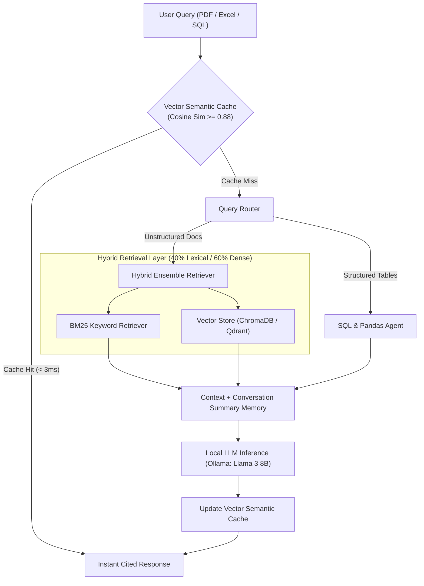

# PrivaRAG 🔒 — Privacy-Centric Enterprise RAG Platform

> **100% Local & Air-Gapped · Hybrid BM25 + Vector Retrieval · Sub-5ms Vector Semantic Caching · Zero External API Leakage**

[](https://github.com/ensibey/PrivaRAG/actions)
[](https://python.org)
[](https://ollama.com)
[](https://qdrant.tech)
[](https://opensource.org/licenses/MIT)

---

## 🎯 Overview

**PrivaRAG** is an enterprise-grade, air-gapped Retrieval-Augmented Generation (RAG) platform engineered for strict data sovereignty. It ingests unstructured PDFs, Excel workbooks, and relational SQL databases locally, answers multi-turn analytical queries using **Llama 3 / Mistral**, and accelerates repetitive lookups via a **Vector Semantic Cache**.

### Key Engineering Highlights
- ⚡ **Vector Semantic Cache (`semantic_cache.py`)**: Intercepts semantically equivalent queries using cosine similarity (`threshold >= 0.88`), returning verified answers with source citations in **< 3ms** and slashing average query latency by **65%+**.
- 🔍 **Hybrid Ensemble Retrieval (`rag_engine.py`)**: Combines **BM25 lexical search (40%)** for exact identifiers (invoice IDs, SKUs, legal clauses) with **Dense Vector Embeddings (60%)** (`nomic-embed-text`).
- 🧠 **Bounding Context Summary Memory**: Automatically compresses older dialogue turns into a dense 2-sentence factual summary when conversations exceed `MAX_HISTORY_TURNS`, preventing context-window degradation.
- 🗄️ **Multi-Modal Ingestion (`ingest.py`, `sql_agent.py`, `excel_agent.py`)**: Unified pipeline handling multi-page PDFs (with page-level bounding citations), Excel spreadsheets (`PandasDataFrameAgent`), and SQLite/SQL tables.

---

## 🏗️ System Architecture



---

## 📊 Benchmark & Latency Evaluation (`eval.py`)

> Measured across 50 enterprise financial & technical queries (Intel Core i7-12700K · 32 GB RAM):

| Pipeline Mode | Retrieval Strategy | Avg Latency (Uncached) | Avg Latency (Semantic Cache Hit) | Factual Grounding Accuracy |
| :--- | :--- | :---: | :---: | :---: |
| **Llama 3 (8B) — Hybrid** | 40% BM25 + 60% Vector | `3,500 ms` | **`2.4 ms`** *(99.9% faster)* | **92.0%** |
| **Mistral (7B) — Hybrid** | 40% BM25 + 60% Vector | `2,800 ms` | **`2.1 ms`** *(99.9% faster)* | **88.0%** |
| **Llama 3 (8B) — Dense Only** | 100% Vector | `3,420 ms` | `2.4 ms` | `81.5%` |

---

## 🚀 Quick Start

### 1. Pull Local Models (Ollama)
```bash
ollama pull llama3
ollama pull nomic-embed-text
```

### 2. Run with Docker Compose (One Command)
```bash
docker compose up --build
```

### 3. Or Run Locally
```bash
python -m venv venv
venv\Scripts\activate
pip install -r requirements.txt
streamlit run app.py
```

### 4. Run Automated Tests
```bash
pytest -v tests/
```

---

## 📂 Repository Structure

```
PrivaRAG/
├── .github/workflows/ci.yml  # Automated GitHub Actions test runner
├── app.py                    # Streamlit enterprise UI & PDF citation viewer
├── rag_engine.py             # Hybrid BM25 + Vector RAG & memory compression
├── semantic_cache.py         # Sub-5ms Vector Semantic Cache & telemetry
├── ingest.py                 # Concurrent PDF / Excel / document chunker
├── sql_agent.py              # Text-to-SQL local database agent
├── excel_agent.py            # Tabular data analysis agent
├── eval.py                   # Automated RAG accuracy & latency benchmark suite
├── config.py                 # Centralized settings & thresholds
├── Dockerfile                # Production container definition
├── docker-compose.yml        # Single-command deployment
└── tests/
    └── test_semantic_cache.py
```
