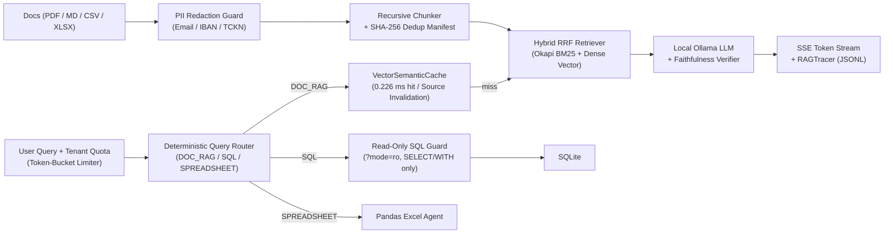

# PrivaRAG

[](https://github.com/ensibey/PrivaRAG/actions/workflows/ci.yml)


**Air-gapped, privacy-first enterprise RAG engine** built for zero external API egress. Combines **Okapi BM25 + dense cosine Reciprocal Rank Fusion (RRF)** retrieval, **PII redaction**, **SHA-256 incremental deduplication**, **source-scoped semantic caching**, **citation/numeric faithfulness verification**, **per-tenant token-bucket rate limiting**, **SSE token streaming**, **structured JSONL tracing**, and **read-only natural-language SQLite/Excel routing** via local Ollama.

---

## Architecture



---

## Key Capabilities

- **Hybrid Sparse + Dense Retrieval (`bm25_retriever.py`, `hybrid_retriever.py`):** Zero-dependency Okapi BM25 (English + Turkish Unicode tokenization) fused with dense cosine embeddings via Reciprocal Rank Fusion (`k=60`).
- **Source-Scoped Vector Semantic Cache (`semantic_cache.py`):** Matches repeat queries above `0.90` cosine similarity in `<1 ms` and supports `invalidate_source(doc)` when underlying policies change.
- **Read-Only SQL Safety Gate (`sql_guard.py`):** Blocks stacked statements and destructive DDL/DML (`DROP`, `DELETE`, `UPDATE`, `INSERT`, `ATTACH`, `PRAGMA`) before execution, and opens SQLite in native `?mode=ro` URI mode.
- **Air-Gapped PII Redaction (`pii_guard.py`):** Masks emails, phones, IBANs, credit cards, and checksum-verified Turkish National IDs (TCKN).
- **Observability, Quotas & Streaming (`observability.py`):** Per-stage JSONL `RAGTracer`, per-tenant `TenantRateLimiter` (Token-Bucket), and `stream_sse_tokens()` SSE generator.
- **Zero-LLM Faithfulness & Citation Verifier (`faithfulness.py`):** Flags hallucinated financial numbers and out-of-range `[n]` citations against retrieved chunks.

---

## Reproducible Retrieval & Cache Benchmark

Measured on the 15-document, 15-query enterprise corpus (`benchmarks/corpus.py` — finance, security, HR, engineering, legal):

```bash
python benchmarks/run_benchmark.py
```

| Method | Recall@1 | Recall@3 | MRR | NDCG@3 | Mean Latency |
| :--- | :---: | :---: | :---: | :---: | :---: |
| **Okapi BM25 (Sparse)** | `100.0%` | `100.0%` | `1.000` | `1.000` | `0.025 ms` |
| **Dense Cosine** | `100.0%` | `100.0%` | `1.000` | `1.000` | `0.220 ms` |
| **Hybrid RRF (BM25 + Dense)** | `100.0%` | `100.0%` | `1.000` | `1.000` | `0.295 ms` |
| **VectorSemanticCache Hit** | `100.0% hit` | — | — | — | `0.226 ms` |

---

## Quick Start

### 1. Offline CLI (Zero API Keys / No Ollama Required)

```bash
python cli.py search docs/ "air-gapped SQLite deployment"
python cli.py redact "Contact ahmet@corp.com, IBAN TR330006100519786457841326"
python cli.py audit-sql "SELECT region, SUM(revenue) FROM sales GROUP BY region"
python cli.py route "Compare Q3 budget column in the Excel sheet"
```

### 2. One-Command Docker & Local Ollama Stack

```bash
docker compose up --build
```

### 3. Run Tests

```bash
pytest -v tests/
```

---

## License

MIT
